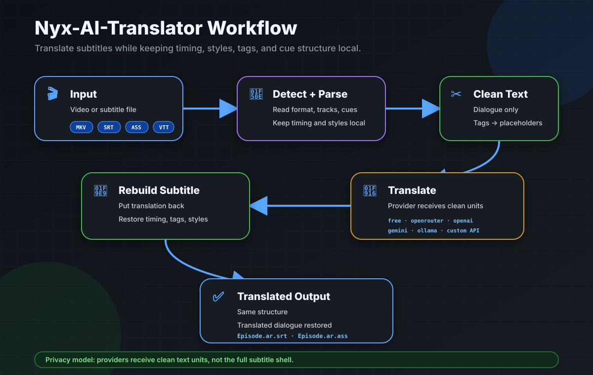
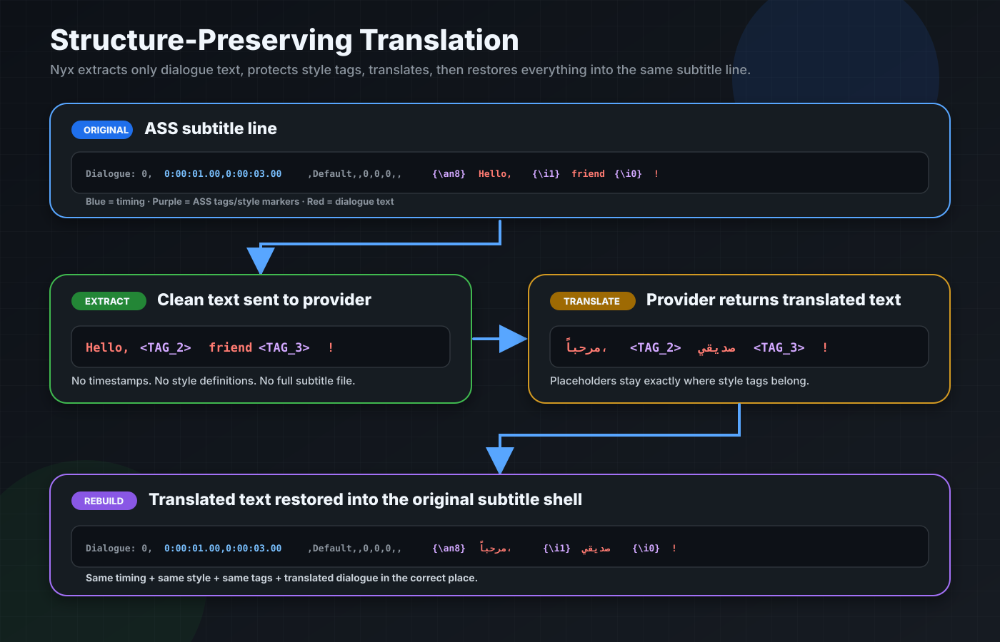

# Nyx-AI-Translator

Structure-preserving AI subtitle translator in a single Python script.

Nyx-AI-Translator does **not** ask a model to rewrite your whole subtitle file. It parses subtitles, extracts only the visible text, translates that text, then rebuilds the original subtitle shell with timing and styling preserved.

## How it works

Nyx-AI-Translator keeps subtitle structure local. Only clean dialogue text is sent to the selected translator/provider.



## Structure-preserving translation

Instead of sending the whole subtitle file to the AI, the tool separates subtitle structure from dialogue.



Example ASS subtitle line:

```ass
Dialogue: 0,0:00:01.00,0:00:03.00,Default,,0,0,0,,{\an8}Hello, {\i1}friend{\i0}!
```

The tool extracts only the dialogue text and protects style tags as placeholders:

```json
[{"id": "1", "text": "Hello, <TAG_2>friend<TAG_3>!"}]
```

The translator returns:

```json
[{"id": "1", "text": "مرحباً، <TAG_2>صديقي<TAG_3>!"}]
```

Then Nyx-AI-Translator rebuilds the original subtitle line:

```ass
Dialogue: 0,0:00:01.00,0:00:03.00,Default,,0,0,0,,{\an8}مرحباً، {\i1}صديقي{\i0}!
```

Timing, style, font, ASS tags, and subtitle structure stay in the correct place.

## Features

- Interactive CLI for normal users.
- External subtitle translation: `.srt`, `.ass`, `.ssa`, `.vtt`, `.webvtt`.
- Embedded subtitle extraction from video files with `ffprobe` + `ffmpeg`.
- Manual embedded subtitle track selection.
- Translate from/to any language supported by the selected provider.
- ASS/SSA preservation: timing, styles, fields, and override tags are kept.
- SRT preservation: cue numbers and timestamps are kept.
- VTT/WebVTT input is converted to SRT output by default.
- Same-folder output using language suffix naming, e.g. `Episode 01.ar.ass`.
- Free/default provider via `deep-translator` for rough/testing translations with no API key.
- Recommended quality provider: OpenRouter/OpenAI/Gemini-style LLMs.
- Requirement checker.
- Validation and smaller-chunk retry on failure.

## Requirements

- **Python 3.10+** — required to run the script.
- Python packages from `requirements.txt`:
  - `requests`
  - `deep-translator`
- **Required for embedded subtitle mode:**
  - `ffprobe`
  - `ffmpeg`
  - Install with the tool: `py -3 Nyx-AI-Translator.py --install-deps --yes` on Windows, or the OS command printed by `--check`.
- Optional but recommended for future robust MKV extraction:
  - `mkvextract` from MKVToolNix

## Install

### Windows quick start

If you are on Windows, read [`WINDOWS_QUICK_START.md`](WINDOWS_QUICK_START.md).

Fast path from PowerShell in this folder:

```powershell
powershell -ExecutionPolicy Bypass -File .\install-windows.ps1
.\run-windows.bat --check
.\run-windows.bat
```

The `run-windows.bat` launcher tries `py -3` first, then `python`, so it avoids the common Microsoft Store `python was not found` problem.

### Manual install

First install Python 3.10+:

- Windows: <https://www.python.org/downloads/windows/> or `winget install Python.Python.3.11`
- macOS: <https://www.python.org/downloads/macos/> or `brew install python`
- Linux: use your distro package manager, e.g. `sudo apt install python3 python3-pip`

Then install Python packages:

```bash
python -m pip install -r requirements.txt
```

For embedded subtitles, install FFmpeg:

### Windows

```powershell
winget install Gyan.FFmpeg
winget install MoritzBunkus.MKVToolNix
```

### macOS

```bash
brew install ffmpeg mkvtoolnix
```

### Ubuntu/Debian

```bash
sudo apt update
sudo apt install ffmpeg mkvtoolnix
```

`mkvextract` / MKVToolNix is optional for future robust MKV handling. v1 uses ffmpeg extraction.

## Check requirements

```bash
python Nyx-AI-Translator.py --check
```

## Interactive use

```bash
python Nyx-AI-Translator.py
```

Menu:

```text
[1] Embedded subtitle inside video
[2] External subtitle file
[3] Settings / Providers
[4] Check requirements
[5] Exit
```

## External subtitle example

```bash
python Nyx-AI-Translator.py --subtitle "Episode 01.en.srt" --from en --to ar --provider free
```

Output:

```text
Episode 01.ar.srt
```

## Embedded subtitle example

First check tracks interactively:

```bash
python Nyx-AI-Translator.py
```

Or direct mode if you know the subtitle track index:

```bash
python Nyx-AI-Translator.py --video "Episode 01.mkv" --track 0 --from en --to ar --provider free
```

Output:

```text
Episode 01.ar.ass
```

## Provider configuration

Run the interactive settings menu:

```bash
python Nyx-AI-Translator.py
```

Then choose:

```text
[3] Settings / Providers
```

Config is stored at:

- Windows: `%APPDATA%\\Nyx-AI-Translator\\config.json`
- macOS/Linux: `~/.config/nyx-ai-translator/config.json`

Environment variables override config:

```text
OPENROUTER_API_KEY
OPENAI_API_KEY
GEMINI_API_KEY
DEEPL_API_KEY
GOOGLE_TRANSLATE_API_KEY
AZURE_TRANSLATOR_KEY
AZURE_TRANSLATOR_ENDPOINT
AZURE_TRANSLATOR_REGION
OLLAMA_BASE_URL
NYX_TRANSLATOR_PROVIDER
NYX_TRANSLATOR_MODEL
```

## Provider notes

Default provider is `free`, using `deep-translator` GoogleTranslator with MyMemory fallback. It is useful for testing and quick rough translations, but it is **not publish-quality**, especially for Arabic subtitles with jokes, fantasy terms, or long ASS lines.

Recommended quality path:

- `openrouter` — easiest API-key workflow; recommended for real episodes.
- `openai` / `gemini` — good direct API options if you already use them.
- `ollama` / `custom_openai` — local or custom OpenAI-compatible servers; quality depends on the model.
- `deepl`, `google_cloud`, `azure` — stable machine-translation APIs, usually weaker than LLMs for subtitle context.
- `auto` — fallback testing only; for serious output pick one provider directly.

For Arabic output, the tool warns if likely untranslated English words remain, for example ordinary words like `evil`, `next`, or `during`. Proper nouns/acronyms can still be valid and may remain untranslated.

## Provider quality guide

| Provider | API key needed | Best for | Quality |
|---|---:|---|---|
| `free` | No | Testing, quick rough subtitles | Basic |
| `openrouter` | Yes | Real subtitle translation | Recommended |
| `openai` | Yes | High-quality subtitle translation | Recommended |
| `gemini` | Yes | High-quality subtitle translation | Recommended |
| `ollama` | Local server | Private/local workflows | Depends on model |
| `deepl` / `google_cloud` / `azure` | Yes | Stable machine translation | Good, less context-aware |

For publish-quality Arabic subtitles, use `openrouter`, `openai`, or `gemini`. The `free` provider is useful for testing but may produce awkward or literal translations.

AI/provider options:

- `openrouter`
- `openai`
- `gemini`
- `deepl`
- `google_cloud`
- `azure`
- `ollama`
- `custom_openai`
- `auto`

## Test

```bash
python -m pytest tests -q
```

## Status

v0.1.0 is an MVP. It has working parsers/rebuilders, provider plumbing, config, and CLI. Next recommended work:

- Better provider integration testing with real API keys.
- Add mkvextract-first fallback for MKV subtitle extraction.
- Add folder/batch mode.
- Add more subtitle edge-case tests.
- Add optional translator note.

## License

MIT
